

# Prime Expert Cargo

**A full-stack logistics platform I designed and built: a Flutter mobile app, a Next.js customer website, a React operations dashboard and a Node.js API, all on Firebase Authentication and PostgreSQL.**

[Demo video](assets/demo/prime-expert-cargo-demo.mp4) · [Screenshots](#screenshots) · [How it works](#how-it-works) · [Engineering highlights](#engineering-highlights) · [Live site](#try-it) · [Contact](#contact)

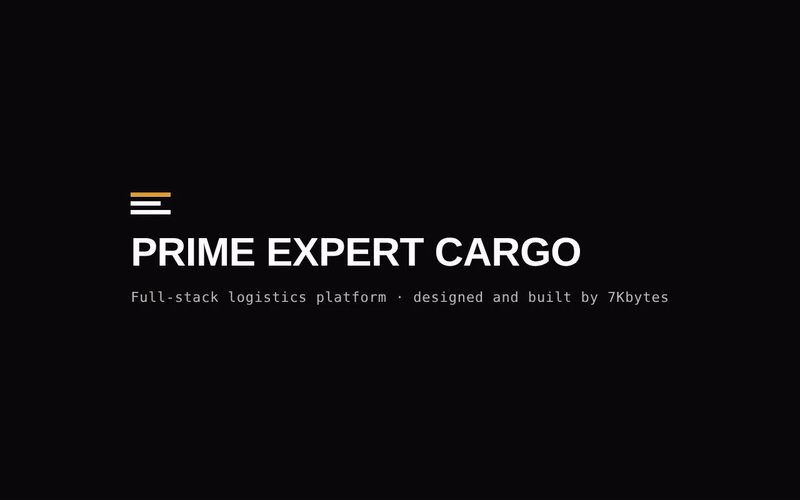

> **Portfolio case study.** I built this platform for Prime Expert Cargo LLC, a freight forwarder shipping cargo from Dubai to Ghana. This repository shows my work. The source code is private, and nothing here is open for reuse. See [All Rights Reserved](#all-rights-reserved).

## At a glance

| | |
| --- | --- |
| **What I built** | 4 apps: customer website, Flutter mobile app, operations dashboard and REST API |
| **My role** | Sole developer: product design, UI design system, frontend, mobile, backend, database, auth, deployment and CI |
| **Stack** | Flutter · Next.js 14 · React 18 · Node.js/Express · Prisma · PostgreSQL · Firebase Auth · Vercel |
| **Quality** | 32 API tests, 51 Flutter tests, lint and builds for every app, all in GitHub Actions on every push |
| **Status** | Website, dashboard and API live in production; mobile app complete, not yet in the stores |

## The problem

Ghanaians in the UAE send a lot of goods home: electronics, clothing, car parts, furniture and stock for small businesses. These shipments are usually arranged by phone and WhatsApp. Prices and delivery dates live in chat threads, paperwork is handwritten, and the only way to find a parcel is to call and ask.

The sender doesn't know where the cargo is, the receiver in Ghana knows even less, and the freight company spends its day answering "where is my shipment?"

## The solution

I moved the whole shipment lifecycle into one system:

1. **Book.** The customer books a shipment or asks for a quote on the website or the mobile app. They enter sender, receiver and cargo details and choose air freight, sea freight or door-to-door.
2. **Approve.** The operations team replies with a price and an estimated delivery date, or rejects the request with a reason.
3. **Track.** Each shipment moves through nine stages, from Dubai pickup to delivery in Ghana. Every change is logged with a location, shows up in the customer's account and is sent by email.
4. **Share.** Each shipment gets a tracking number. Anyone who has it can follow the cargo without an account, and the public page leaves out names and personal details.

## Features

| Customers (web and mobile) | Operations dashboard | Platform |
| --- | --- | --- |
| Book a shipment or request a quote | Approval queue: quote and delivery date | Email/password and Google sign-in |
| Air freight, sea freight or door-to-door | Reject with a reason | Email verification and password reset |
| Live status timeline per shipment | Status updates with location and notes | Email at every step |
| Public tracking without an account | All bookings with search and filters | Roles enforced by the server |
| In-app notifications | Booking detail with full history | Rate limiting and input validation |
| Saved receiver addresses | Customer list with booking history | CI on every push |

## Screenshots

### Customer website (Next.js)

| Home | Public tracking |
| --- | --- |
| 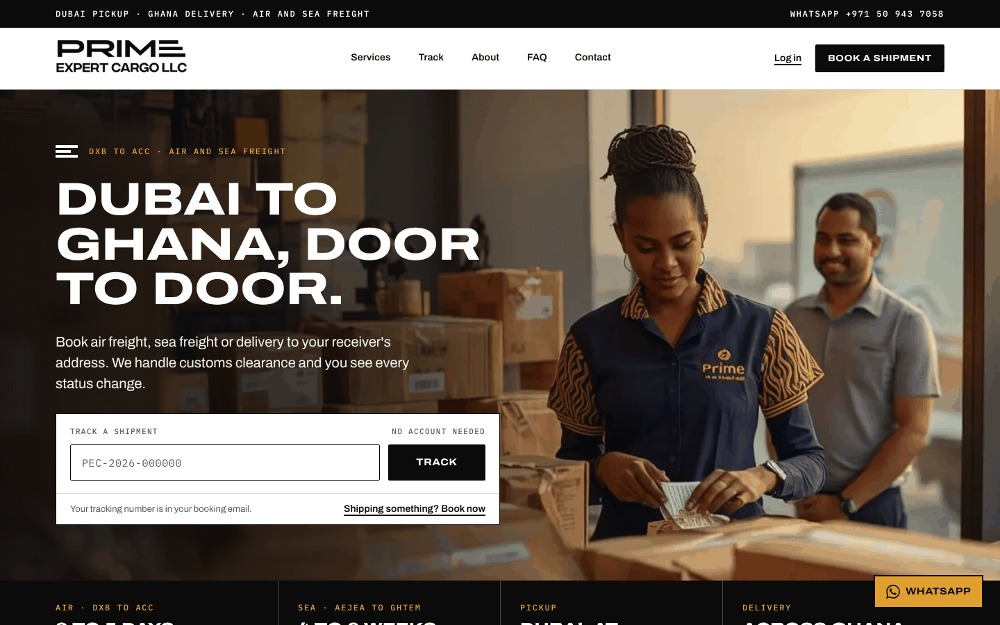 | 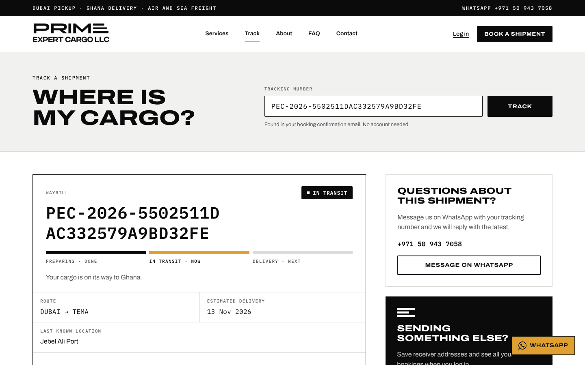 |

| Customer dashboard | New booking | Shipment details |
| --- | --- | --- |
| 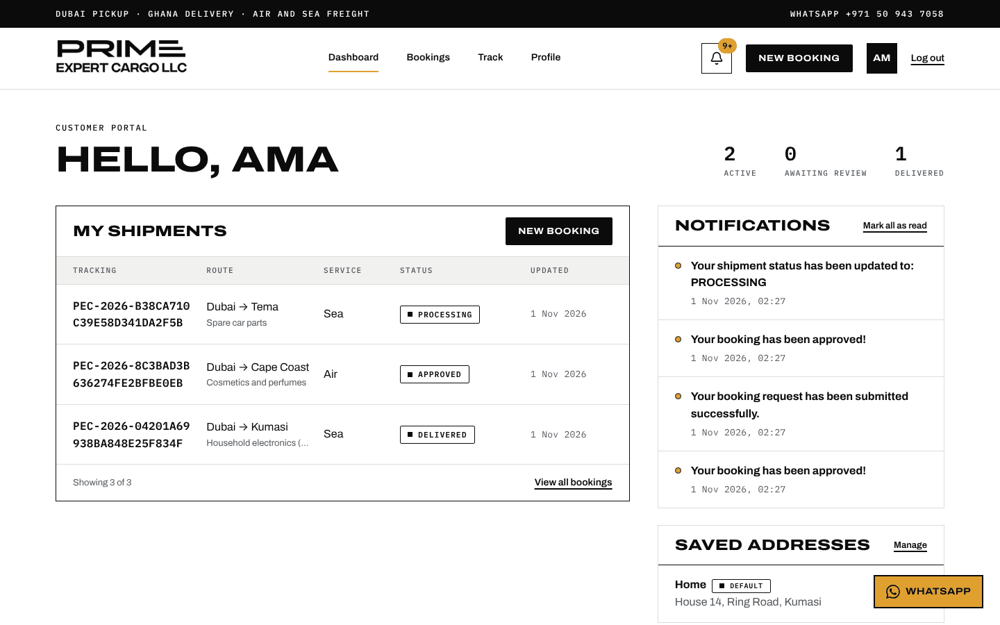 | 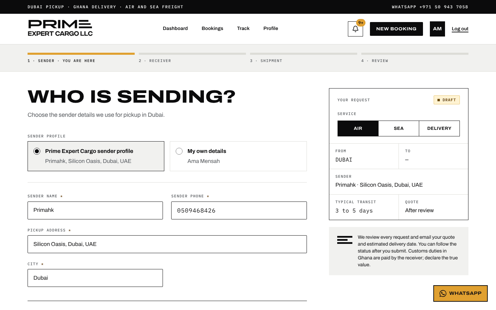 | 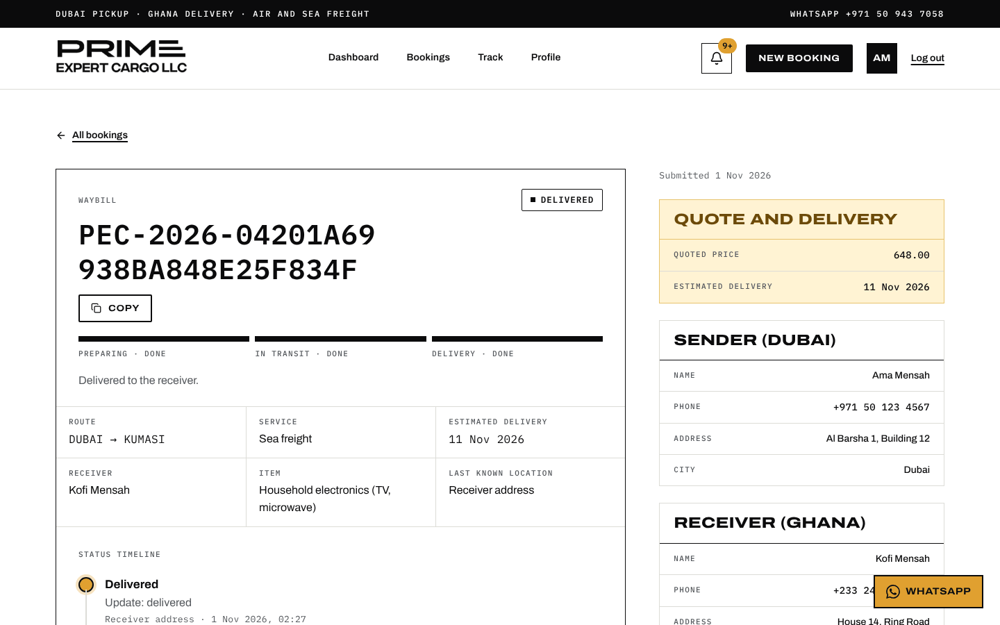 |

### Mobile app (Flutter)

| Sign in | Home | My bookings | Shipment |
| --- | --- | --- | --- |
| 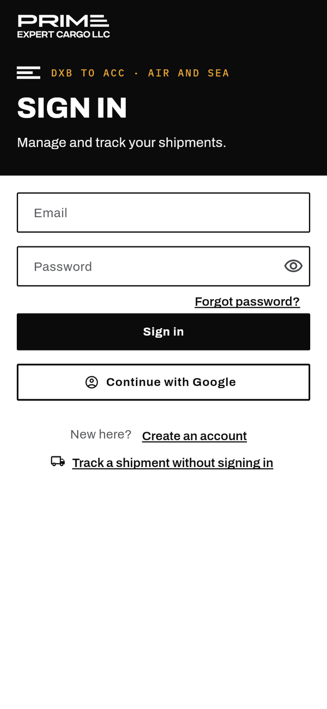 | 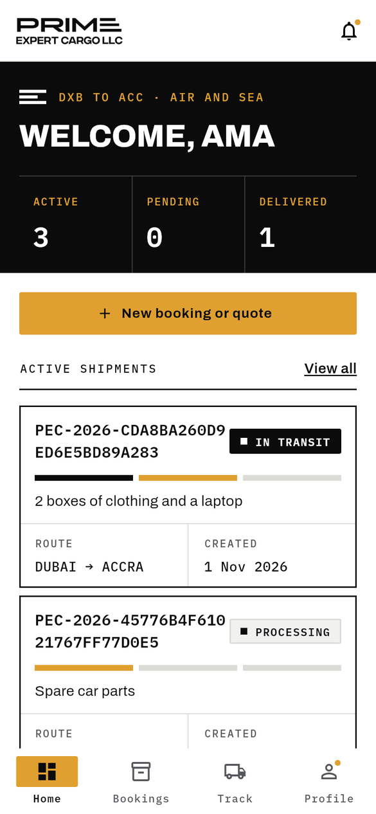 | 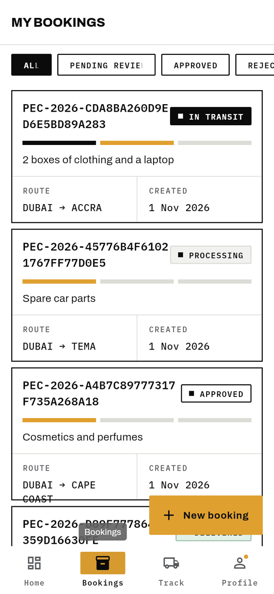 | 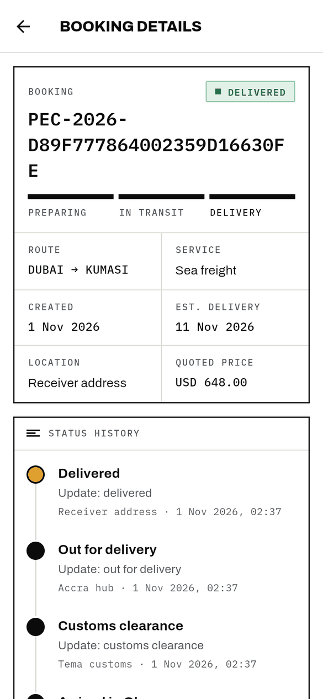 |

| Status history | Track | New booking |
| --- | --- | --- |
| 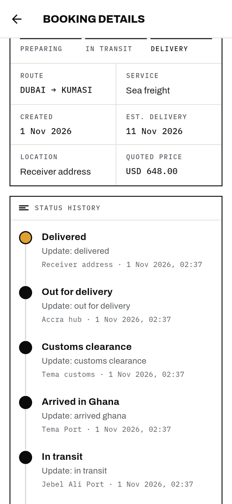 | 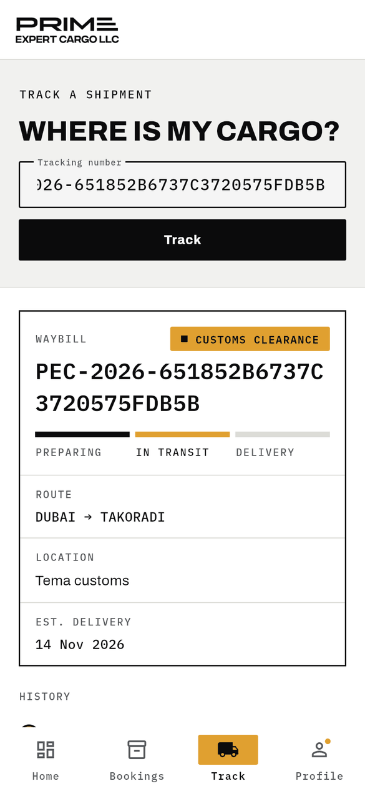 | 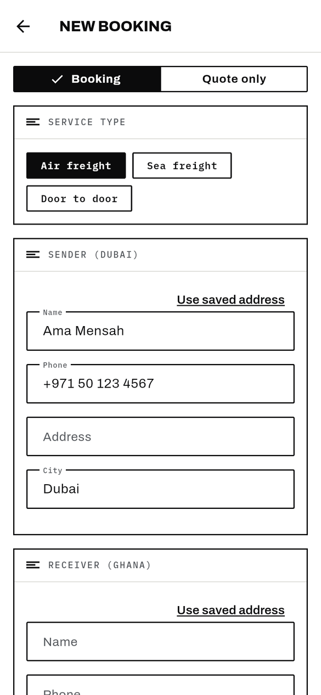 |

### Operations dashboard (React, Ant Design)

| Overview | Pending requests |
| --- | --- |
| 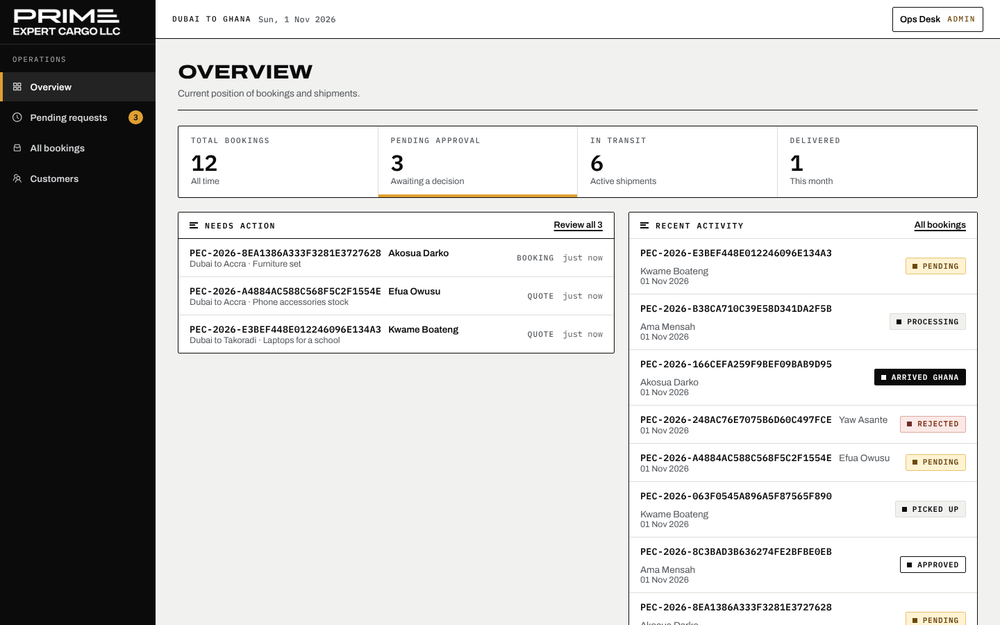 | 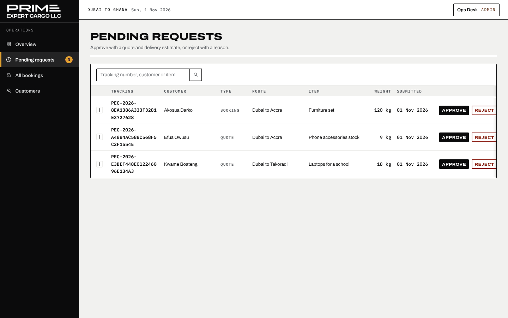 |

| All bookings | Booking detail and status update |
| --- | --- |
| 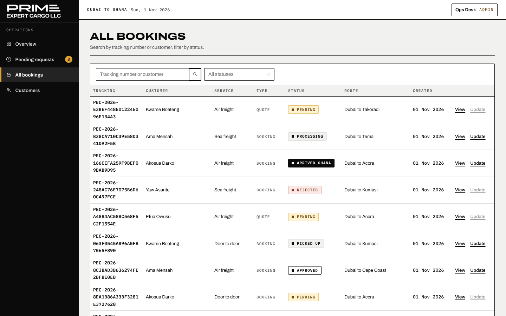 | 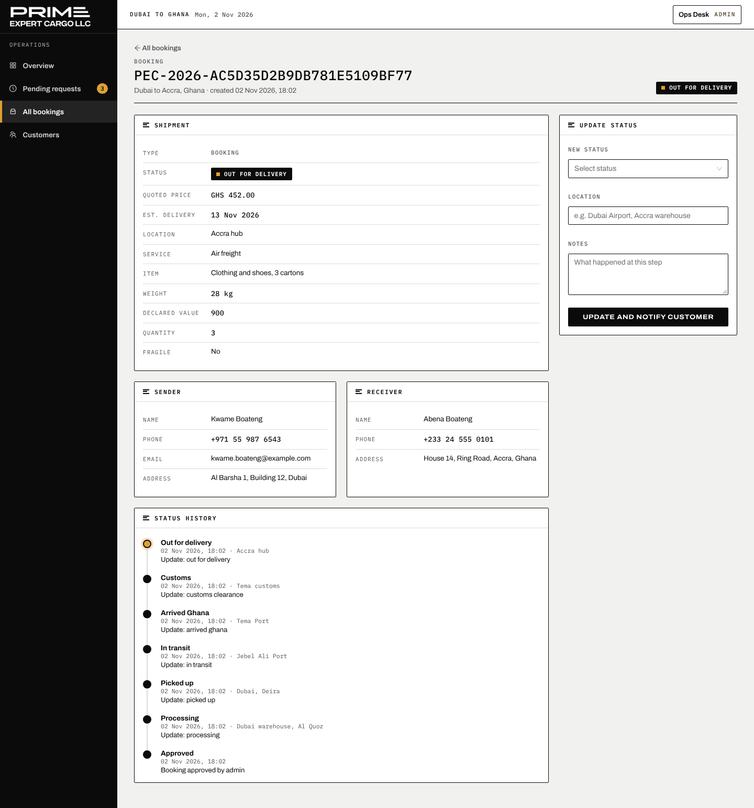 |

All screenshots and recordings show the real apps running against the real API and a PostgreSQL database filled with **sample data**. Every customer, receiver and tracking number is invented.

## Demo video

▶ **[Watch the 90-second demo](assets/demo/prime-expert-cargo-demo.mp4)** (MP4, plays in the browser on GitHub)

It follows one shipment through all three apps:

1. A customer in Dubai signs in and books air freight to Accra.
2. The operations team approves it with a price and a delivery date.
3. The team opens the booking and moves it to *Picked up*, then *In transit*.
4. The receiver in Ghana tracks it with only the tracking number.

## How it works

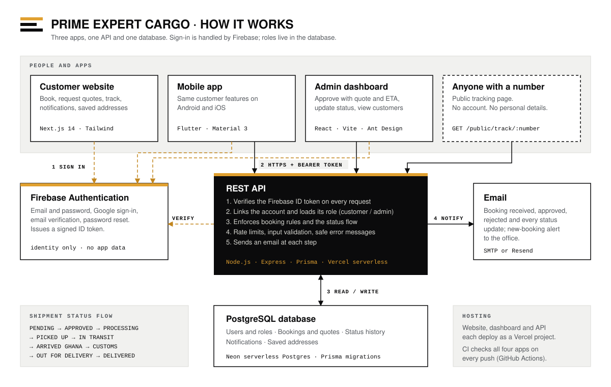

- **Sign-in** goes through Firebase Authentication. The apps never handle or store passwords.
- **Every API request** carries a signed Firebase ID token. The API verifies it, looks up the user's role in PostgreSQL and only then runs the action.
- **Business rules live on the server.** A booking can only be approved while it is pending, statuses only move forward, and customers can't set prices or statuses.
- **Public tracking** returns progress and route only. It never exposes names, item descriptions or internal notes.

## Engineering highlights

**Security**
- Verifies Firebase ID tokens on the server with Google's public keys. The API needs no service-account secret.
- Blocks account takeover: a Firebase account can only be linked to an existing user record if its email is verified. Admin access also requires a verified email on every request.
- Uses an allow-list of the booking fields a customer may set, so prices, statuses and approvals can only come from the operations team.
- Rate limits auth endpoints, validates all input, caps page sizes and never sends internal error messages to clients.
- Generates tracking numbers with cryptographic randomness so they can't be guessed.

**Reliability**
- Runs multi-step writes (booking plus notification, approval plus history) in database transactions that roll back together.
- Enforces the shipment status flow on the server and rejects backward or repeated changes.
- Waits for email sends before the serverless function returns, but an email failure never fails a saved change.

**Product and design**
- One design system shared by the website, the dashboard and the Flutter app: tokens, type, status chips and a three-phase progress bar.
- The Flutter app is built against interfaces for auth and API, so its 51 widget and unit tests run with fakes and no network.

**Delivery**
- GitHub Actions runs API tests, Prisma validation, lint, production builds for both web apps, and Flutter analyze and tests on every push.
- The website, dashboard and API deploy as three Vercel projects; the database is Neon serverless Postgres with Prisma migrations.

## Tech stack

| Area | Technology |
| --- | --- |
| Mobile app | Flutter, Dart, Material 3, provider |
| Customer website | Next.js 14, React, Tailwind CSS, Zustand, Axios |
| Operations dashboard | React 18, Vite, Ant Design, TanStack Query, Zustand |
| API | Node.js, Express, Prisma, express-validator, Helmet |
| Database | PostgreSQL (Neon) |
| Auth | Firebase Authentication (email and password, Google) |
| Email | SMTP or Resend |
| Hosting and CI | Vercel, GitHub Actions |

## The market

The platform serves the **UAE to Ghana shipping corridor**. Its users are Ghanaians living and working in Dubai who send goods home to family, and small traders importing electronics, clothing, spare parts and household goods for resale in Accra, Kumasi, Tema and other cities.

Most freight forwarders on this route still take bookings by phone and WhatsApp. Online booking, written quotes and live tracking set a forwarder apart, and the same platform can serve other Gulf to West Africa routes.

## Traction

- The customer website, operations dashboard and API are deployed in production for Prime Expert Cargo LLC.
- The Flutter app is complete and tested but not yet published to the app stores.
- Customer and shipment numbers are not published.

## Try it

- **Live site:** [primeexpertcargollc.com](https://primeexpertcargollc.com) (backup: [prime-expert-cargo-web.vercel.app](https://prime-expert-cargo-web.vercel.app))
- **Demo video:** [assets/demo/prime-expert-cargo-demo.mp4](assets/demo/prime-expert-cargo-demo.mp4)
- **Android APK:** not available yet

## Contact

Interested in working together or seeing more of my work?

- **Email:** [7kbytesgh@gmail.com](mailto:7kbytesgh@gmail.com)
- **Portfolio:** [portfolio-eta-ivory-yshi67xev0.vercel.app](https://portfolio-eta-ivory-yshi67xev0.vercel.app)
- **GitHub:** [@7kbytes](https://github.com/7kbytes)

**More of my work**

- [Primahk](https://github.com/7kbytes/primahk-showcase): a classifieds marketplace for Ghana (Next.js, React Native, NestJS, PostgreSQL)
- [Maestro Sports](https://github.com/7kbytes/maestrosports-showcase): a production website for a football management company in Dubai and Ghana (Next.js)

## All Rights Reserved

© 2026 7Kbytes. All Rights Reserved. Nothing in this repository may be copied, modified, distributed or reused without prior written permission. See [LICENSE](LICENSE).
